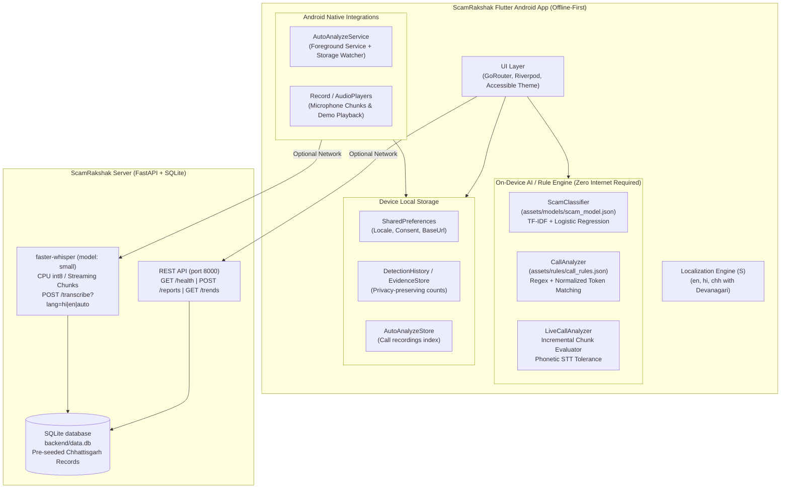

# ScamRakshak: Technical Project Documentation

> **Offline-first Android application designed to detect scam messages and calls, teach digital payment safety in English, Hindi, and Chhattisgarhi, and assist in reporting cyber fraud.**

---

## Table of Contents
1. [Executive Summary & Purpose](#1-executive-summary--purpose)
2. [Architecture & Technology Stack](#2-architecture--technology-stack)
3. [Folder Ownership & Team Contracts](#3-folder-ownership--team-contracts)
4. [Complete Feature Breakdown & Implementation](#4-complete-feature-breakdown--implementation)
   - [4.1 Offline Message Scam Detector](#41-offline-message-scam-detector)
   - [4.2 Call Scam Analyzer](#42-call-scam-analyzer)
   - [4.3 Live Call Guard (Real-Time Audio Stream)](#43-live-call-guard-real-time-audio-stream)
   - [4.4 Automatic Call Recording Analyzer](#44-automatic-call-recording-analyzer)
   - [4.5 Fraud Incident Reporting & National Helpline](#45-fraud-incident-reporting--national-helpline)
   - [4.6 Interactive Safety Lessons](#46-interactive-safety-lessons)
   - [4.7 Fraud Awareness Quiz System](#47-fraud-awareness-quiz-system)
   - [4.8 Scam Trends & Local Detection Analytics](#48-scam-trends--local-detection-analytics)
   - [4.9 Trilingual Accessibility & UI System](#49-trilingual-accessibility--ui-system)
5. [End-to-End Data Flows](#5-end-to-end-data-flows)
6. [Machine Learning Pipeline & Engine Implementation](#6-machine-learning-pipeline--engine-implementation)
7. [Backend Architecture & API Specifications](#7-backend-architecture--api-specifications)
8. [Repository Directory & File Catalog](#8-repository-directory--file-catalog)
9. [Setup, Execution & Testing Guide](#9-setup-execution--testing-guide)
10. [Feature Verification & Implementation Status Matrix](#10-feature-verification--implementation-status-matrix)
11. [Known Limitations, Constraints & Roadmap](#11-known-limitations-constraints--roadmap)

---

## 1. Executive Summary & Purpose

### 1.1 Problem Statement
Digital payments (UPI, AePS, mobile banking) have expanded rapidly across India, including rural and semi-urban communities. However, cybercrime, phishing SMS, fake KYC threats, digital arrest coercion, and predatory loan app scams have escalated proportionately. Vulnerable populations—especially first-time smartphone users, rural elders, and non-English speakers—face high financial and psychological risk due to:
- Inability to recognize sophisticated social engineering and urgency tactics.
- Linguistic barriers (most security advisories are published in technical English or formal Hindi).
- Intermittent or absent internet connectivity in remote areas, making cloud-only AI detectors unreliable.
- Delayed reporting, leading to irrecoverable financial loss.

### 1.2 The ScamRakshak Solution
**ScamRakshak** ("Scam Protector") is an **offline-first Android cybersecurity platform** engineered for regional resilience:
- **100% Offline Core Detection:** Text classification and call transcript analysis run completely on-device without cloud APIs or data transmission, preserving privacy and ensuring safety without an active internet connection.
- **Multilingual Native Experience:** Full native support for **English**, **Hindi** (हिन्दी), and **Chhattisgarhi** (छत्तीसगढ़ी) with genuine Devanagari script, avoiding robotic transliterations.
- **Accessible, Low-Cognitive-Load UI:** Tailored for rural usability with generous touch targets (min 48–56 dp), high contrast teal/green trust palette, and intuitive visual cues.
- **Comprehensive Lifecycle Coverage:** Prevention (*Lessons & Quizzes*), Detection (*SMS & Call Analyzers, Live Call Guard*), and Action (*Incident Reporting & 1930 National Helpline Integration*).

---

## 2. Architecture & Technology Stack



### 2.1 Technology Stack Details

| Layer | Component | Version / Specification | Role in ScamRakshak |
| :--- | :--- | :--- | :--- |
| **Mobile Framework** | Flutter | SDK `^3.14.0` (Dart 3.5+) | Cross-platform UI toolkit targeting Android. |
| **State Management** | `flutter_riverpod` | `^2.5.1` | Dependency injection, reactive state, and locale management. |
| **Routing** | `go_router` | `^14.2.0` | Declarative routing with deep linking support. |
| **Data Visualization** | `fl_chart` | `^0.68.0` | Offline fraud trends charts and category breakdown graphs. |
| **Audio & Media** | `record`, `audioplayers` | `^6.1.1`, `^6.1.1` | Microphone chunk recording and sample playback for Live Call Guard. |
| **Background Service** | `flutter_foreground_task` | `^8.18.0` | Foreground task for automatic call recording analysis. |
| **Local Storage** | `shared_preferences` | `^2.3.0` | Locale persistence, server URL configuration, and local stats. |
| **System Integrations** | `url_launcher`, `file_picker` | `^6.3.0`, `^10.3.10` | Dialing `1930`, external web reporting, and file selection. |
| **Permissions** | `permission_handler` | `^11.4.0` | Microphone, audio storage, and notification permissions. |
| **Typography** | `Noto Sans Devanagari` | Bundled asset | Offline Devanagari font rendering across all devices. |
| **Backend Framework** | FastAPI | `^0.115.0` (Python 3.10+) | High-performance asynchronous REST backend. |
| **Speech-to-Text** | `faster-whisper` | `^1.1.0` (CTranslate2) | Offline/local Whisper transcription (default `small`, int8 CPU). |
| **Database** | SQLite3 | Python standard library | Local database storing pre-seeded and incoming fraud reports. |
| **Machine Learning** | `scikit-learn` | 1.6+ (Training pipeline) | TF-IDF n-grams + Logistic Regression, exported to pure JSON. |

---

## 3. Folder Ownership & Team Contracts

Per `AGENTS.md`, codebase responsibilities are partitioned strictly to enable concurrent multi-developer workflows without merge collisions:

```
+-------------------------------------------------------------------------------+
| ScamRakshak Team Ownership Structure                                          |
+-------------------------------------------------------------------------------+
| Sayanthan:                                                                    |
|   lib/core/                                -> Theme, Localization, Routing,   |
|                                               API Client, Providers           |
|   lib/features/message_detector/           -> SMS & WhatsApp Checker UI       |
|   lib/features/call_detector/              -> Call Transcript & Audio Screen  |
|   lib/features/report/                     -> Fraud Reporting Form & 1930 Dial|
+-------------------------------------------------------------------------------+
| Radhika:                                                                      |
|   lib/engine/                              -> Models, Classifier, Analyzers   |
|   assets/models/                           -> scam_model.json                 |
|   assets/rules/                            -> call_rules.json                 |
|   assets/samples/                          -> Transcripts & Live Audio Clips  |
|   ml/                                      -> Dataset Prep, Training, Export  |
+-------------------------------------------------------------------------------+
| Aagam:                                                                        |
|   backend/                                 -> FastAPI, SQLite, faster-whisper |
|   lib/features/lessons/                    -> Lesson Viewer & Flashcards      |
|   lib/features/quiz/                       -> Interactive Quiz Screen         |
|   lib/features/dashboard/                  -> Scam Trends & Local Analytics   |
|   assets/lessons/                          -> 11 Lesson JSON definitions      |
|   assets/quiz/                             -> 7 Quiz JSON definitions         |
|   assets/data/                             -> District & Seeding Datasets     |
+-------------------------------------------------------------------------------+
```

### 3.1 Locked Contracts (Signatures Cannot Be Changed)

```dart
// 1. Data Contract: lib/engine/models.dart
class Reason { String phrase; double weight; }
class ScamResult { String label /* 'scam'|'genuine' */; double score /* 0..1 */; List<Reason> reasons; }
class CallMatch { String phrase; String scriptType; }
class CallResult { String risk /* 'high'|'medium'|'low' */; List<CallMatch> matches; }

// 2. Scam Classifier Contract: lib/engine/scam_classifier.dart
static Future<ScamClassifier> ScamClassifier.load();
ScamResult classify(String text);

// 3. Call Analyzer Contract: lib/engine/call_analyzer.dart
static Future<CallAnalyzer> CallAnalyzer.load();
CallResult analyze(String transcript);

// 4. Live Call Guard Contract: lib/engine/live_call_analyzer.dart
class LiveCallState { String risk; double score; List<CallMatch> matches; List<CallMatch> newMatches; String transcript; }
class LiveCallAnalyzer { static Future<LiveCallAnalyzer> load(); LiveCallState add(String chunkText); void reset(); }

// 5. API Client Contract: lib/core/api_client.dart
Future<Map> transcribe(File audio);
Future<void> postReport(String type, String district);
Future<List<Map>> getTrends();
```

---

## 4. Complete Feature Breakdown & Implementation

### 4.1 Offline Message Scam Detector
- **Route:** `/message`
- **Location:** `lib/features/message_detector/message_detector_screen.dart`
- **What it does:** Scans suspect SMS or WhatsApp messages for fraud patterns (e.g., electricity bill disconnection threats, lottery prizes, fake KYC expirations, APK installation prompts).
- **Execution Workflow:**
  1. User pastes text or selects one of the 8 quick presets from `message_examples.dart`.
  2. The text is passed synchronously to `ScamClassifier.classify(text)`.
  3. Preprocessing converts URLs to ` urltoken `, strips non-word punctuation, extracts word unigrams and bigrams, matches against the 19,366-entry vocabulary, applies IDF weights, computes $L_2$ norm, and applies logistic regression weights + sigmoid.
  4. Returns a `ScamResult`:
     - **Verdict:** `SCAM` (Red badge) vs `GENUINE` (Green badge).
     - **Probability Score:** Visual confidence meter (e.g., `98.4% Scam Risk`).
     - **Reason Chips:** Top 5 contributing phrases identified by model weights (e.g., `"click link"`, `"account suspended"`, `"apk"`).
     - **Action Guidance:** Contextual safety instructions in the active language.
     - **Report Fraud CTA:** Pre-fills and navigates to `/report`.
  5. Privacy-preserving recording: Logs detection count in `detection_history.dart` without storing message content.

### 4.2 Call Scam Analyzer
- **Route:** `/call`
- **Location:** `lib/features/call_detector/call_detector_screen.dart`
- **What it does:** Evaluates suspected scam phone calls using either an uploaded audio recording or pasted call transcript.
- **Execution Workflow:**
  - **Audio Flow:** Uploads audio file (`.wav`, `.mp3`, `.m4a`, `.ogg`) to `POST /transcribe`. If the backend is unreachable (`ApiOfflineException`), the UI displays a clear offline warning and offers bundled offline sample transcripts to explore.
  - **Transcript Flow:** Invokes `CallAnalyzer.analyze(transcript)` synchronously on-device.
  - **Scoring & Risk Meter:** Matches phrases across 10 scam script categories loaded from `call_rules.json`. Computes capped subscores per category, handles negation windows (e.g., *"do not share your OTP"* is negated and not scored as a threat), and classifies into `HIGH`, `MEDIUM`, or `LOW` risk.
  - **Visual Highlighting:** Highlights matched phrases directly inside the transcript using `call_highlight.dart`.
  - **Direct Escalation:** "Report this Call" button navigates to `/report` with `initialType: 'call'`.

### 4.3 Live Call Guard (Real-Time Audio Stream)
- **Route:** `/live`
- **Location:** `lib/features/live_call/live_call_screen.dart`
- **What it does:** Monitors ongoing phone calls on speakerphone in real-time, streaming 6-second microphone chunks to the transcription engine, analyzing incremental speech, and triggering immediate haptic vibration and visual alerts the moment fraud markers appear.
- **Key Modules:**
  - `LiveCallAnalyzer` (`lib/engine/live_call_analyzer.dart`): Tolerates ASR transcription noise and phonetic Devanagari speech-to-text confusions (e.g., matching `"दिजितल अरेस्ट"` to `"डिजिटल अरेस्ट"`).
  - `live_call_io.dart`: Handles microphone recording through `record` and audio playback through `audioplayers`.
  - **Silence Suppression:** Evaluates peak dBFS levels (threshold: `-45 dBFS`); silent chunks are discarded locally to save bandwidth and compute.
  - **Demo Mode:** Includes 5 complete bundled audio scenarios (`scam_digital_arrest`, `scam_fake_kyc_otp`, `scam_courier_customs`, `genuine_family_call`, `genuine_bank_service`) with line-by-line spoken MP3s in `assets/samples/live/audio/` for instant demonstration without a live call.
  - **Haptic Emergency Trigger:** On `HIGH` risk detection, activates device vibration, flashes a prominent emergency red card, and presents a 1-tap "Hang Up & Report" button.

### 4.4 Automatic Call Recording Analyzer
- **Routes:** `/call/auto`, `/call/recording`
- **Location:** `lib/features/call_detector/auto_analyze_service.dart`, `auto_analyze_screen.dart`
- **What it does:** Runs a background foreground service that monitors the user's call recording directory (`/Recordings/Call/`). When a new recording finishes, it automatically transcribes and analyzes the call, triggering a local notification with the risk level.
- **Key Modules:**
  - `AutoAnalyzePlatform`: Manages Android `MANAGE_EXTERNAL_STORAGE` / `READ_MEDIA_AUDIO` permissions, notification channels, and battery optimization bypass requests.
  - `AutoAnalyzeStore`: Indexed database of analyzed call recordings, cached transcripts, risk ratings, and matched threat categories.
  - `call_timeline.dart`: Interactive visual playback timeline showing exactly at what minute and second suspicious phrases were uttered during the call.
  - `RecordingResultScreen`: Full post-call report accessible by tapping the notification.

### 4.5 Fraud Incident Reporting & National Helpline
- **Route:** `/report`
- **Location:** `lib/features/report/report_screen.dart`
- **What it does:** Streamlines reporting fraud incidents to both the ScamRakshak community database and official Indian cybersecurity law enforcement.
- **Key Features:**
  - **Direct Hotline Dialing:** Primary CTA to call the **National Cyber Crime Helpline `1930`** directly (`tel:1930`) with package-visibility queries configured in AndroidManifest.
  - **Official Portals:** Direct links to `cybercrime.gov.in` and Department of Telecommunications **Chakshu** portal (`sancharsaathi.gov.in/sfc/`).
  - **Structured Incident Report:** Form capturing fraud category (`otp`, `fake_qr`, `loan_app`, `call`, `other`), district (10 Chhattisgarh districts), and timestamps.
  - **Resilient Submission:** Asynchronously posts to `POST /reports`. If offline, data is queued locally in `EvidenceStore` without blocking the user.
  - **Evidence Checklist:** Interactive checklist helping victims preserve critical evidence (bank statements, SMS screenshots, caller IDs, transaction UTR numbers) before evidence is deleted by fraudsters.

### 4.6 Interactive Safety Lessons
- **Route:** `/lessons`
- **Location:** `lib/features/lessons/lesson_list_screen.dart`, `lesson_detail_screen.dart`
- **What it does:** Educational hub teaching digital payment safety across 11 core fraud scenarios with visual flashcards.
- **Lesson Catalog:**
  1. `otp` — OTP Safety (Never share OTP with anyone)
  2. `upi_pin` — UPI PIN Rules (PIN is required only to *send* money, never to receive)
  3. `qr` — Fake QR Code Scams (Scanning a QR code debits your account)
  4. `atm_pin` — ATM Card & PIN Security
  5. `digital_arrest` — Digital Arrest Scam (Police/CBI never arrest people over video calls)
  6. `fake_kyc` — Fake Bank/SIM KYC Alerts
  7. `loan_app` — Predatory Instant Loan Apps & Extortion
  8. `courier_customs` — Courier / Customs Drug Parcel Threats
  9. `lottery_prize` — Fake KBC / Lottery Prize Schemes
  10. `phishing` — Phishing Links & Electricity Bill Scams
  11. `remote_access` — Remote Access Apps (AnyDesk, TeamViewer risks)
- **Features:** Trilingual text in all cards, search filter, category filter, completion checkmarks, and persistence in `LessonProgress`.

### 4.7 Fraud Awareness Quiz System
- **Route:** `/quiz`
- **Location:** `lib/features/quiz/quiz_screen.dart`
- **What it does:** Gamified assessment module testing user knowledge with immediate feedback and scoring.
- **Modes:**
  - **Quick Quiz:** 5 randomized questions from all categories.
  - **Full Quiz:** Complete set of questions across topics.
  - **Topic Quiz:** Targeted quiz for a specific lesson (e.g., after completing the Digital Arrest lesson).
- **Features:** Instant visual feedback (green/red animations), detailed explanations in the user's active language, score summary, high-score tracking in `QuizStore`, and retry mechanisms.

### 4.8 Scam Trends & Local Detection Analytics
- **Route:** `/dashboard`
- **Location:** `lib/features/dashboard/trends_screen.dart`
- **What it does:** Visualizes real-time and offline scam trends by combining on-device detection logs with aggregated backend server reports.
- **Features:**
  - **Local Phone History:** Tracks how many scam messages and calls were blocked on this device, filterable by practice vs real detections.
  - **District Heatmap / Breakdown:** Aggregates reports from `GET /trends` covering 10 Chhattisgarh districts (Raipur, Durg, Bilaspur, Korba, Raigarh, Bastar, Rajnandgaon, Dhamtari, Surguja, Janjgir-Champa).
  - **Graphical Trends:** Dynamic interactive bar and pie charts rendered via `fl_chart`.
  - **Educational Cross-Linking:** Clicking a fraud category in the chart automatically links to the corresponding lesson (e.g., clicking `loan_threat` opens the Loan App lesson).

### 4.9 Trilingual Accessibility & UI System
- **Location:** `lib/core/strings.dart`, `theme.dart`, `widgets/language_switcher.dart`
- **What it does:** Provides instant, app-wide language switching across English, Hindi, and Chhattisgarhi without restarting the app.
- **Implementation:**
  - `S` class acts as the centralized dictionary. Features dynamically register their strings via `S.register(Map)` during initialization.
  - Riverpod `localeProvider` manages the reactive state and persists choices to `SharedPreferences` (`scamrakshak_selected_locale`).
  - High accessibility light theme with deep teal `#00796B` primary and accessible contrast ratios compliant with first-time digital users.

---

## 5. End-to-End Data Flows

### 5.1 Offline Message Detection Flow

```
[User Pastes SMS / WhatsApp Text]
               │
               ▼
   [MessageDetectorScreen]
               │
               ▼
[ScamClassifier.classify(text)] (Offline on-device)
   ├─► Tokenize & URL replacement
   ├─► 1,2-gram extraction & vocabulary index lookup
   ├─► TF-IDF dot product + intercept calculation
   └─► Sigmoid activation -> Probability score
               │
               ▼
[Return ScamResult: Verdict, Score, Top 5 Reasons]
               │
               ▼
   [UI Displays Verdict & Advice]
               │
               ▼
[recordMessageCheck() -> Saved to Local DetectionHistory]
```

### 5.2 Live Call Guard Real-Time Stream Flow

```
[Phone Call on Speakerphone]
               │
               ▼
   [Microphone Stream (record)]
               │
       (Every 6 Seconds)
               │
               ▼
   [Silence Filter: dBFS < -45?] ──YES──► [Drop chunk locally]
               │ NO
               ▼
[POST /transcribe?lang=hi|en|auto] ──► [FastAPI / faster-whisper]
               │                                │
               │◄─────── {"text": "...", "lang": "hi"} ────────┘
               ▼
[LiveCallAnalyzer.add(chunkText)] (Offline on-device)
   ├─► Phonetic word normalization (Devanagari confusion mapping)
   ├─► Script pattern search (assets/rules/call_rules.json)
   ├─► Capped scoring & negation window checking
   └─► Running risk state calculation
               │
               ▼
[Risk Level Evaluation]
   ├─► LOW: Normal status
   ├─► MEDIUM: Yellow advisory banner
   └─► HIGH: [CRITICAL ALERT]
               ├─► Device Haptic Vibration Triggered
               ├─► Screen flashes emergency alert
               ├─► Highlights threatening speech
               └─► "Hang Up & Report" button activated
```

---

## 6. Machine Learning Pipeline & Engine Implementation

### 6.1 Model Architecture & Training
- **Model Type:** TF-IDF (1,2-grams) + Logistic Regression with balanced class weights ($C=100$).
- **Vocabulary Size:** 19,366 in-vocabulary word unigrams and bigrams.
- **Dataset:** 7,498 augmented training rows (5,881 pre-augmentation), spanning English, Hindi (Devanagari), and Hinglish (Latin transliteration).
- **Evaluation Performance:** Tested on 1,539 hold-out test samples and 68 realistic hand-written samples:

| Evaluation Slice | Sample Size ($n$) | Accuracy | Precision | Recall | $F_1$ Score |
| :--- | :--- | :--- | :--- | :--- | :--- |
| **All Test Data** | 1,539 | **98.38%** | **96.84%** | **96.59%** | **0.9671** |
| **English Slice** | 1,139 | 98.07% | 94.48% | 93.44% | 0.9396 |
| **Hindi (Devanagari)**| 200 | 99.50% | 99.00% | 100.00%| 0.9950 |
| **Hinglish Slice** | 200 | 99.00% | 98.99% | 98.99% | 0.9899 |
| **Hand-Written Only**| 68 | 89.71% | 90.91% | 88.24% | 0.8955 |

### 6.2 Pure-JSON Export & Zero-Dependency Dart Engine
Rather than packaging heavy Python or TensorFlow runtimes, `ml/export_model.py` serializes the exact weights, IDF vectors, intercepts, and regex rules into `assets/models/scam_model.json` (786 KB).

`ScamClassifier` (`lib/engine/scam_classifier.dart`) faithfully reproduces the scikit-learn mathematical formulation in pure Dart:
$$\text{Score} = \sigma\left(\beta_0 + \sum_{j \in \text{vocab}} \frac{\text{tf}_j \cdot \text{idf}_j}{\|x\|_2} \cdot \beta_j\right)$$
Where $\sigma(z) = \frac{1}{1 + e^{-z}}$.

**Parity Guarantee:** Verified by `test/engine/parity_test.dart`, confirming $< 10^{-6}$ mathematical discrepancy between Python `scikit-learn` and Flutter `ScamClassifier` on 50 reference samples.

### 6.3 Rule-Based Call Analyzer & STT Phonetic Normalization
`assets/rules/call_rules.json` contains weighted rules across 10 scam script categories:
1. `digital_arrest` (CBI, police, arrest warrant, webcam detention)
2. `fake_kyc` (Bank account blocked, KYC expiry, electricity cut)
3. `courier_customs` (FedEx parcel, customs narcotics, passport seized)
4. `remote_access` (AnyDesk, TeamViewer, QuickSupport download)
5. `otp_request` (Read OTP, verify code, SMS password)
6. `upi_collect` (Accept request, enter UPI PIN to receive money)
7. `loan_threat` (Instant loan, legal action, contact list hacking)
8. `lottery_prize` (KBC lottery winner, registration deposit)
9. `telecom_threat` (SIM disconnection within 2 hours)
10. `electricity_bill` (Power disconnection tonight)

**Phonetic Tolerance in `LiveCallAnalyzer`:**
Audio transcription often misinterprets colloquial Devanagari. `LiveCallAnalyzer.normalizeWord()` folds phonetically similar characters:
- Short and long vowels: `ि/ी`, `ु/ू`
- Dental and retroflex consonants: `त/ट`, `द/ड`, `थ/ठ`
- Sibilants: `श/ष/स` $\to$ `स`
- Nukta folding: `क़/क`, `फ़/फ`, `ज़/ज`

---

## 7. Backend Architecture & API Specifications

The backend service is located in `backend/` and implemented with **Python FastAPI**, **SQLite3**, and **faster-whisper**.

### 7.1 Server Configuration
- **Entry Point:** `backend/main.py`
- **Default Port:** `0.0.0.0:8000`
- **Database:** `backend/data.db` (auto-initialized and pre-seeded with 300 realistic Chhattisgarh fraud records).
- **Whisper Model:** Default `small` on CPU with `int8` quantization (steered via `HINDI_PROMPT` to output Devanagari script).

### 7.2 REST API Endpoints

#### 1. Healthcheck: `GET /health`
Returns service availability, Whisper model load state, and report count.
- **Response `200 OK`:**
  ```json
  {
    "status": "ok",
    "model_loaded": true,
    "reports_count": 300
  }
  ```

#### 2. Speech-to-Text: `POST /transcribe`
Accepts multipart audio file upload (`.wav`, `.mp3`, `.m4a`, `.ogg`) and optional `?lang=hi|en|auto` query parameter.
- **Request:** Multipart form with `file: Binary`
- **Response `200 OK`:**
  ```json
  {
    "text": "आपका बिजली का बिल बकाया है, तुरंत अपडेट करें।",
    "lang": "hi"
  }
  ```
- **Silent Chunk Handling:** If audio has no audible speech, returns `{"text": "", "lang": "hi"}`.

#### 3. Submit Fraud Incident: `POST /reports`
Records a fraud incident in SQLite.
- **Request `POST /reports`:**
  ```json
  {
    "type": "otp",
    "district": "Raipur",
    "ts": "2026-11-23T14:00:00Z"
  }
  ```
- **Response `201 Created`:**
  ```json
  {
    "status": "success",
    "id": 301
  }
  ```

#### 4. Aggregated Fraud Trends: `GET /trends`
Returns district-level aggregated incident counts.
- **Response `200 OK`:**
  ```json
  [
    {"district": "Raipur", "type": "otp", "count": 23},
    {"district": "Raipur", "type": "fake_qr", "count": 14},
    {"district": "Durg", "type": "fake_qr", "count": 15}
  ]
  ```

---

## 8. Repository Directory & File Catalog

```
ScamRakshak/
├── AGENTS.md                                # Project rules, locked contracts, and folder ownership
├── pubspec.yaml                             # Dependencies, fonts, and asset declarations
├── analysis_options.yaml                    # Dart analysis and linter rules
├── README.md                                # General project overview
│
├── android/                                 # Native Android host configuration
│   └── app/src/main/AndroidManifest.xml     # Permissions (INTERNET, RECORD_AUDIO), queries (tel, https)
│
├── assets/                                  # Bundled application assets (100% offline)
│   ├── fonts/
│   │   └── NotoSansDevanagari-Regular.ttf   # Bundled Devanagari typography
│   ├── models/
│   │   └── scam_model.json                  # Exported TF-IDF + Logistic Regression parameters
│   ├── rules/
│   │   └── call_rules.json                  # Capped keyword rules for scam scripts
│   ├── lessons/                             # 11 interactive safety lesson packs (JSON)
│   ├── quiz/                                # 7 quiz topic question banks (JSON)
│   └── samples/                             # Test transcripts and live MP3 call chunks
│       └── live/                            # Line-by-line audio and transcripts for Live Guard
│
├── lib/                                     # Flutter application source code
│   ├── main.dart                            # App initialization, ProviderScope, GoRouter
│   │
│   ├── core/                                # Core shared architecture (Sayanthan)
│   │   ├── api_client.dart                  # Backend communication client & offline handling
│   │   ├── providers.dart                   # Riverpod provider definitions
│   │   ├── router.dart                      # Declarative GoRouter configuration (all 11 routes)
│   │   ├── strings.dart                     # Centralized localization engine (class S)
│   │   ├── theme.dart                       # AppTheme (accessible light theme, teal/navy)
│   │   ├── screens/
│   │   │   └── home_screen.dart             # Primary dashboard with 6 tiles + Live Call banner
│   │   └── widgets/
│   │       └── language_switcher.dart       # Reusable 3-chip language switcher
│   │
│   ├── engine/                              # On-device detection engines (Radhika)
│   │   ├── models.dart                      # Locked data contracts (ScamResult, CallResult)
│   │   ├── scam_classifier.dart             # Pure Dart TF-IDF + Logistic Regression evaluator
│   │   ├── call_analyzer.dart               # Transcript pattern matcher with negation windows
│   │   └── live_call_analyzer.dart          # Real-time incremental ASR-noise tolerant analyzer
│   │
│   └── features/                            # Domain-specific feature modules
│       ├── message_detector/                # SMS/WhatsApp scam checker screen and presets
│       ├── call_detector/                   # Call audio/transcript checker & timeline visualizer
│       ├── live_call/                       # Live Call Guard screen, mic streamer, demo player
│       ├── report/                          # Fraud reporting form & 1930 direct dialing
│       ├── lessons/                         # Flashcard safety lessons & progress tracking
│       ├── quiz/                            # Interactive safety quiz & score tracker
│       └── dashboard/                       # District trends charts & local detection history
│
├── backend/                                 # FastAPI server & Whisper transcription (Aagam)
│   ├── main.py                              # FastAPI REST endpoints & lifespan loader
│   ├── database.py                          # SQLite schema, pre-seeded Chhattisgarh data
│   ├── models.py                            # Pydantic schemas
│   ├── requirements.txt                     # Python backend dependencies
│   ├── bench.py                             # Transcription latency benchmarks
│   └── test_all_endpoints.py                # Automated backend test suite
│
├── ml/                                      # Machine learning training pipeline (Radhika)
│   ├── build_dataset.py                     # Multilingual scam dataset builder & augmentations
│   ├── preprocess.py                        # Tokenization, URL replacement, Devanagari rules
│   ├── train.py                             # scikit-learn training script
│   ├── export_model.py                      # Serializes model to pure JSON
│   ├── handwritten_test.py                  # Evaluation on realistic human test samples
│   └── results.md                           # Detailed model benchmark documentation
│
└── test/                                    # Automated test suites (218 tests passing)
    ├── engine/                              # ML parity, classifier, call analyzer tests
    └── features/                            # Live Call, Lessons, Quiz, Layout, and Trends tests
```

---

## 9. Setup, Execution & Testing Guide

### 9.1 Mobile Application (Flutter)

#### Prerequisites
- Flutter SDK `^3.14.0` (Dart 3.5+)
- Android Studio / Android SDK with platform tools

#### Commands
```bash
# 1. Fetch dependencies
flutter pub get

# 2. Run static analysis
flutter analyze

# 3. Execute all 218 automated tests
flutter test

# 4. Launch app on connected device / emulator
flutter run
```

### 9.2 Backend Server (Python FastAPI)

#### Prerequisites
- Python 3.10+
- Virtual environment recommended

#### Commands
```bash
# 1. Navigate to backend
cd backend

# 2. Create and activate virtual environment
python -m venv venv
.\venv\Scripts\Activate.ps1    # Windows PowerShell
source venv/bin/activate       # macOS / Linux

# 3. Install dependencies
pip install -r requirements.txt

# 4. Start backend server (runs on http://0.0.0.0:8000)
uvicorn main:app --host 0.0.0.0 --port 8000 --reload

# 5. Run backend tests
python test_all_endpoints.py
```

### 9.3 Machine Learning Pipeline (Retraining Model)

```bash
cd ml
pip install -r requirements.txt

# Build dataset -> Train model -> Export JSON to assets/models/
python build_dataset.py
python train.py
python export_model.py
```

---

## 10. Feature Verification & Implementation Status Matrix

The following matrix distinguishes between **Code-Implemented**, **Test-Verified** (automated test passing), and **Real-Device Verified**:

| Feature Component | Implementation Status | Automated Test Verification | Real-Device Verified | Notes |
| :--- | :---: | :---: | :---: | :--- |
| **Offline Message Detector** | Complete | **Verified** (`detector_screens_test.dart`) | Code Verified | 100% on-device; classifies English, Hindi, Hinglish. |
| **Call Transcript Analyzer** | Complete | **Verified** (`call_analyzer_test.dart`) | Code Verified | 10 scam script categories; handles negation windows. |
| **Live Call Guard (Demo Mode)**| Complete | **Verified** (`live_call_test.dart`) | Code Verified | 5 bundled multi-lingual audio scenarios with audio playback. |
| **Live Call Guard (Mic Stream)**| Complete | **Verified** (`live_call_test.dart`) | Hardware Dependent | Records 6s chunks, uploads to backend, triggers alert. |
| **Automatic Call Recording Scan**| Complete | **Verified** (`auto_analyze_test.dart`) | OS Dependent | Android 11+ requires user to grant All Files access. |
| **Call Timeline Breakdown** | Complete | **Verified** (`recording_inbox_test.dart`)| Code Verified | Visual timeline pinpoints when threats occurred. |
| **1930 Helpline Dialing** | Complete | **Verified** (`report_screen_test.dart`) | Code Verified | Launches `tel:1930` via `url_launcher`. |
| **Cybercrime Portal Links** | Complete | **Verified** (`report_screen_test.dart`) | Code Verified | External links to cybercrime.gov.in and Chakshu. |
| **Safety Lessons (11 Topics)** | Complete | **Verified** (`lessons_test.dart`) | Code Verified | Fully translated in `en`, `hi`, `chh` with picture cards. |
| **Interactive Safety Quizzes** | Complete | **Verified** (`quiz_test.dart`) | Code Verified | Random question selector, scoring, and explanation cards. |
| **District Scam Trends** | Complete | **Verified** (`trends_test.dart`) | Code Verified | Local phone records + remote SQLite aggregation. |
| **Trilingual Localization** | Complete | **Verified** (`phone_layout_test.dart`) | Code Verified | Immediate language switching with zero restart required. |
| **FastAPI Backend Services** | Complete | **Verified** (`test_all_endpoints.py`)| Code Verified | Health, transcribe, reports, and trends operational. |
| **faster-whisper STT** | Complete | **Verified** (`test_live_transcribe.py`)| Code Verified | Tested with base/small models on multi-lingual samples. |

---

## 11. Known Limitations, Constraints & Roadmap

### 11.1 Technical Constraints & Operating System Quirks
1. **Android Call Recording Restrictions:**
   - On Android 10 and newer, third-party call recording APIs are restricted by Google for privacy reasons.
   - The *Automatic Call Recording Analyzer* works by reading files generated by the manufacturer's built-in phone dialer (e.g., Samsung, Xiaomi, or Google Phone call recording folder). On Android 11+, users must grant `MANAGE_EXTERNAL_STORAGE` ("All files access").
2. **Microphone Exclusivity During Calls:**
   - Android prevents secondary background apps from accessing the microphone while an ongoing phone call is in progress. For *Live Call Guard*, the phone call must be placed on **Speakerphone** so the ambient microphone can capture both sides of the conversation.
3. **Whisper Latency on Low-End CPU:**
   - The `small` Whisper model takes ~1.5 to 2.2 seconds to transcribe a 6-second audio chunk on a standard modern CPU. On ultra-low-power edge devices, latency can increase. The system incorporates fallback silence suppression and pre-transcribed demo modes.
4. **Font Asset Requirement:**
   - The app-wide font family requires `assets/fonts/NotoSansDevanagari-Regular.ttf` to be present in the bundle for offline typography.

### 11.2 Future Roadmap
- **On-Device Whisper (LiteRT / ONNX):** Port Whisper to on-device LiteRT/NPU execution, eliminating the local Wi-Fi backend dependency for live call transcription.
- **Dialer Integration via Accessibility Services:** Optional Android Accessibility Service to automatically prompt the user to enable speakerphone upon detecting an unknown caller.
- **Community Threat Broadcast:** Push notifications warning a specific district when an outbreak of a new scam variant (e.g., localized fake electricity bills) is reported in that region.
- **Expanded Regional Dialects:** Extend the language engine beyond Chhattisgarhi to Bhojpuri, Maithili, and Gondi.
