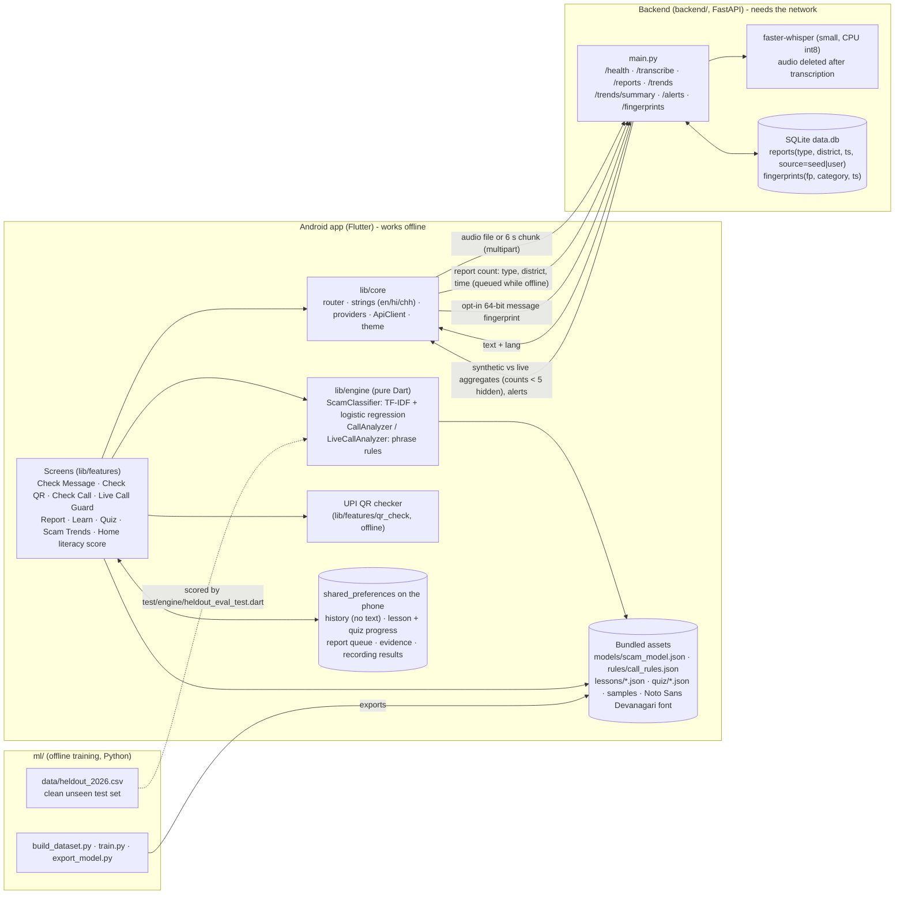

# ScamRakshak architecture

A Flutter Android app that works offline first. A small FastAPI server is used only for speech-to-text, anonymous report counts, trends and alerts.

## Offline vs online

| Works with no internet | Needs the ScamRakshak server |
|---|---|
| Check Message (Dart TF-IDF + LR from `assets/models/scam_model.json`) | Check Call on a recording (`POST /transcribe`, Whisper on the server) |
| Check QR (UPI QR parser and rules) | Live Call Guard mic mode (6 s chunks to `/transcribe`) |
| Lessons, quiz, Digital Financial Literacy Score | Auto-analyze new call recordings (uploads to `/transcribe`) |
| Sample calls, Live Call Guard demo mode | Report counts (`POST /reports`; queued on the phone until online) |
| Report guidance, 1930 dialer, evidence checklist | Server trends (`/trends/summary`) and emerging-scam alerts (`/alerts`) |
| Scam Trends from this phone's own history | Opt-in message fingerprints (`/fingerprints`) |

Opening cybercrime.gov.in and Chakshu needs internet in the browser, but not the ScamRakshak server.

## Data flow and privacy

- **Message check:** the text never leaves the phone. Local history keeps only the verdict, category, score and time. If the user opts in, a 64-bit SimHash and the category are sent, never the text.
- **Call recording / live chunk:** the audio is uploaded to the server, which writes a temporary file, transcribes it and deletes it. Live chunks are deleted on the phone after upload. Auto-analyze never copies or changes the original recording; it keeps the verdict and transcript on the phone (latest 500).
- **Report:** only the scam type, one of 33 districts (or "unknown") and the time. The server rejects free text in `district`. Reports are kept in a queue on the phone while offline and retried when the server can be reached.
- **Trends:** seeded rows (`source=seed`) are shown as "Synthetic demo data". User reports (`source=user`) are shown as "Live reports". Every count below 5 is hidden.
- **Alerts:** a spike is when a district and scam type has at least 5 live reports in the last 7 days and at least twice its weekly average over the 4 weeks before. A cluster is at least 5 opt-in fingerprints in 7 days within 6 bits of each other.

## Ownership

See `AGENTS.md`:
- **Sayanthan:** `lib/core`, message / call / report / qr_check.
- **Radhika:** `lib/engine`, `ml/`, `assets/models|rules|samples`.
- **Aagam:** `backend/`, lessons / quiz / dashboard, `assets/lessons|quiz|data`.
